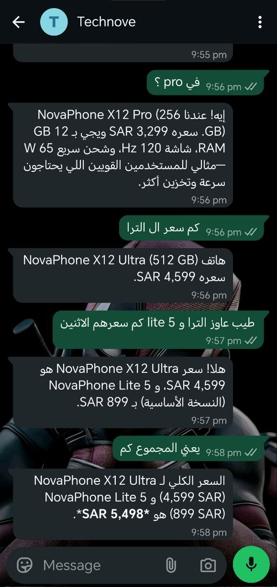

# Technove RAG

**A secure Retrieval-Augmented Generation system for knowledge-based question answering.**

Technove RAG is an AI application designed to make organizational knowledge accessible through natural-language conversations.

The system combines semantic retrieval and Large Language Models to retrieve relevant information and generate context-aware responses, with particular attention to input validation, security controls, and reliable request handling.

## Key Features

### 1. Retrieval-Augmented Generation
- Retrieve relevant information from a knowledge base.
- Generate responses grounded in retrieved context.
- Use semantic search to improve information discovery.
- Reduce dependence on the model's internal knowledge.

### 2. Retrieval Pipeline
The retrieval workflow is designed to improve the relevance of retrieved context through:

- Query rewriting.
- Query expansion.
- Semantic retrieval.
- Result reranking.
- Context preparation before generation.

### 3. LLM Integration
- Integrate external LLM inference through Groq.
- Use `openai/gpt-oss-120b` as the configured model.
- Use structured processing to manage the retrieval and generation workflow.

### 4. Security and Guardrails

The system incorporates multiple layers of protection:

- Input validation.
- Prompt-injection defense.
- Protection against malicious instructions in retrieved content.
- Request rate limiting.
- Execution timeouts and controlled request handling.
- Safer error handling and response processing.

These controls aim to reduce common security and reliability risks in LLM-powered applications.

## Architecture

The application follows a modular RAG architecture:

1. **User Query:** Receives a natural-language question.
2. **Query Processing:** Rewrites or expands the query when needed.
3. **Retrieval:** Searches the knowledge base for relevant content.
4. **Reranking:** Improves the relevance of retrieved results.
5. **Context Assembly:** Prepares the selected information for the LLM.
6. **Generation:** Produces a response grounded in the retrieved context.
7. **Guardrails:** Apply security and request-handling controls throughout the workflow.

## Technology Stack

| Component | Technology |
|---|---|
| Language | Python |
| Agent Orchestration | LangGraph |
| Backend API | FastAPI |
| LLM Provider | Groq |
| Configured LLM | GPT-OSS-120B |
| Embedding Model | all-MiniLM-L6-v2 |
| Core Approach | Retrieval-Augmented Generation |
| Retrieval Enhancement | Query Rewriting, Expansion, and Reranking |

## Engineering Focus

This project focuses on practical LLM engineering challenges beyond basic chatbot implementation:

- Building modular RAG pipelines.
- Improving retrieval quality.
- Connecting retrieval workflows with LLM inference.
- Defending against prompt injection.
- Validating user inputs and retrieved context.
- Implementing rate limits and execution timeouts.
- Designing controlled and maintainable AI backend workflows.

## Project Scope

Technove RAG is an applied AI engineering project demonstrating the design and implementation of a security-conscious RAG application.

The emphasis is on retrieval quality, LLM integration, and application-level safeguards rather than simply connecting a language model to a vector search engine.

The listed features describe the project's implemented design and components; deployment readiness and individual integrations should be evaluated against the repository configuration.

---

**Developed as an AI Engineering portfolio project.**
## Screenshots

### Main Interface
