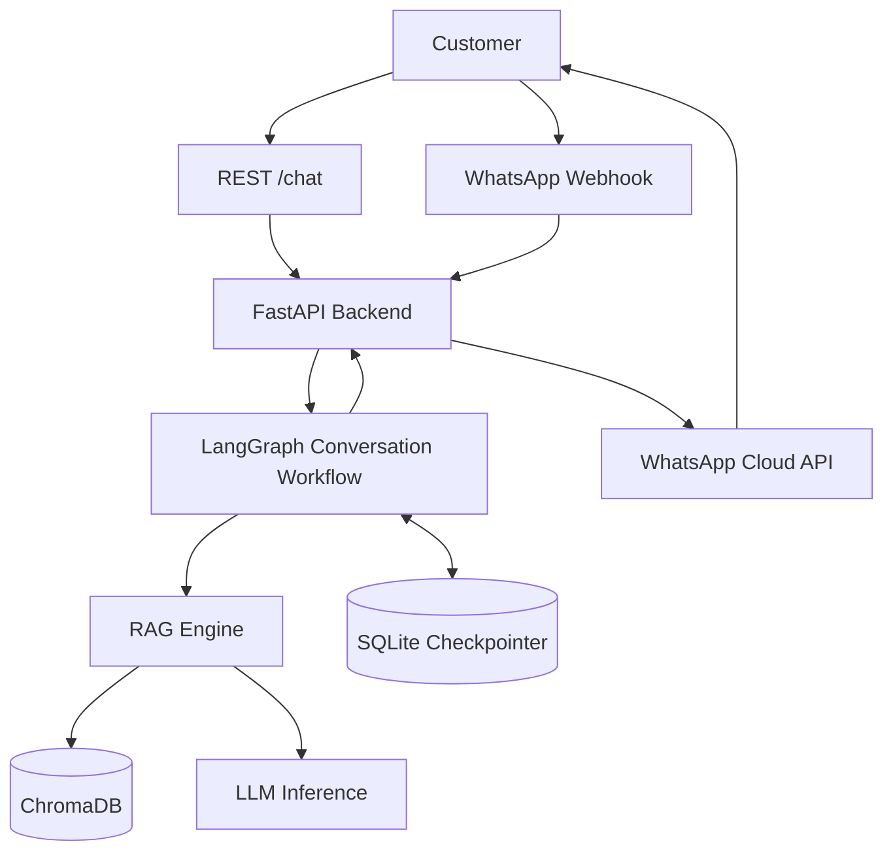
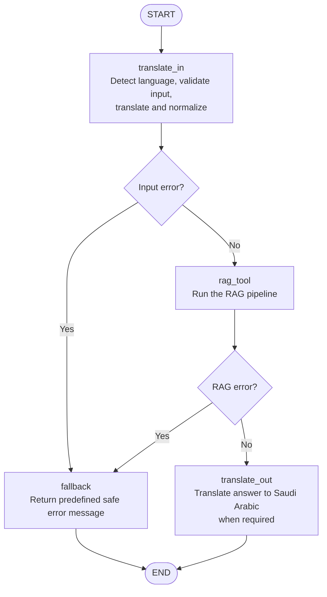
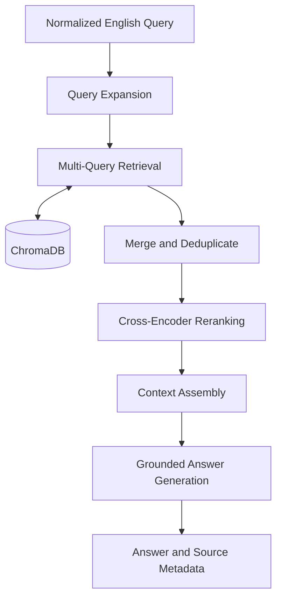

# Technove RAG — Secure Customer Support Assistant
## Screenshots

### Main Interface


**A security-conscious RAG application for conversational customer support, built with LangGraph, FastAPI, ChromaDB, and LLM-powered retrieval.**

[GitHub Repository](https://github.com/ma1868801-afk/technove-rag-customer-support)

---

## Overview

Technove RAG is an AI-powered customer support assistant designed for a fictional electronics retailer operating in Jeddah, Saudi Arabia.

It enables customers to ask questions in natural language and receive context-aware answers based on the organization's product information, frequently asked questions, complaint guidance, and branch information.

The system combines a modular Retrieval-Augmented Generation (RAG) pipeline with a LangGraph conversation workflow. It also provides a FastAPI backend with REST and WhatsApp Cloud API integration.

The engineering focus extends beyond answer generation to include retrieval quality, conversation state, input validation, prompt-injection defenses, request limits, and controlled failure handling.

## Key Capabilities

- Knowledge-grounded customer question answering.
- Query expansion and multi-query semantic retrieval.
- Cross-encoder reranking.
- English and Arabic conversation handling, including Saudi Arabic responses.
- LangGraph-based conversation orchestration.
- Conversation-state persistence using SQLite checkpointing.
- FastAPI REST endpoint and WhatsApp Cloud API webhook.
- Input validation and prompt-injection defenses.
- Request rate limiting and controlled error handling.

## Application Architecture

The application consists of four main layers:

1. **API Layer:** Receives requests through FastAPI REST and WhatsApp webhook endpoints.
2. **Conversation Orchestration:** Uses LangGraph to manage translation, retrieval, response generation, and fallback behavior.
3. **RAG Engine:** Expands queries, retrieves relevant documents, reranks candidates, and generates grounded answers.
4. **Knowledge and State Storage:** Uses ChromaDB for vector retrieval and SQLite for conversation checkpointing.



## LangGraph Conversation Workflow

LangGraph coordinates the conversation lifecycle using a shared state object.

Each request passes through language detection, input validation, translation, RAG execution, and response preparation. Conditional routing sends failures to a dedicated fallback node.



### Node Responsibilities

| Node | Responsibility |
|---|---|
| `translate_in` | Detects the input language, validates and cleans the message, and converts it into a normalized English query. Conversation history can help resolve vague references. |
| `rag_tool` | Executes the RAG engine using the normalized English query and returns an answer with source metadata. |
| `translate_out` | Converts the generated English answer into Saudi Arabic when the original message was Arabic. English answers pass through without an additional translation call. |
| `fallback` | Returns a predefined response in the detected language when validation or RAG processing fails. |

### Conversation State

The graph maintains a shared conversation state containing information such as:

- Original user message.
- User or conversation identifier.
- Conversation history.
- Detected language.
- Normalized English query.
- Generated answer.
- Retrieved source metadata.
- Error information.

A SQLite checkpointer persists graph state using the user's identifier as the LangGraph `thread_id`. This allows conversation history to survive application process restarts.

## Advanced RAG Pipeline

The RAG engine is responsible for retrieving relevant knowledge and generating context-grounded responses.



### Retrieval Stages

**1. Query Expansion**

The LLM generates alternative phrasings of the original question to improve coverage of different terms and expressions.

For example, a question about a phone that will not charge can be expanded into related search expressions about charging problems, battery issues, and power connectivity.

**2. Multi-Query Retrieval**

Each query variant is searched against the ChromaDB vector store using semantic similarity.

The system retrieves candidates for each query and combines them into a shared candidate pool.

**3. Merge and Deduplication**

Retrieved documents are merged, and duplicate entries are removed using document identity metadata.

**4. Cross-Encoder Reranking**

A cross-encoder evaluates the relevance of each candidate against the original query and reorders the results.

**5. Context Assembly**

The highest-ranked passages are formatted into a context block containing document content and source metadata.

**6. Grounded Answer Generation**

The LLM receives the customer's question and the retrieved context. The generation instructions emphasize using the supplied knowledge, avoiding invented product details or policies, and acknowledging insufficient information instead of guessing.

**7. Source Metadata**

The RAG result includes source information such as document title, category, source filename, and relevance score.

## Knowledge Base Ingestion

The source knowledge is organized into Markdown files under `data/`.

| Source File | Content |
|---|---|
| `01_products.md` | Product information and specifications. |
| `02_complaints_faq.md` | Frequently asked questions and complaint guidance. |
| `03_branches_jeddah.md` | Branch information and locations in Jeddah. |

The ingestion module prepares the source documents, creates embeddings, and builds the ChromaDB vector store.

The embedding model and vector-store configuration are managed centrally through the application configuration.

## Security and Reliability

Security controls are applied at the API and conversation-processing layers.

| Control | Purpose |
|---|---|
| Input Validation | Checks and cleans incoming customer messages. |
| Prompt-Injection Defense | Treats user input as data rather than trusted instructions. |
| Retrieved-Content Protection | Reinforces that retrieved content must not override system instructions. |
| Request Rate Limiting | Restricts excessive API requests and repeated WhatsApp messages. |
| Webhook Signature Verification | Verifies incoming WhatsApp webhook signatures. |
| Execution Timeouts and Retries | Controls LLM call duration and retry behavior. |
| Safe Fallback Responses | Provides predefined responses when processing fails. |
| Structured Logging | Records processing stages and operational information. |

These controls reduce common application-level risks; they do not guarantee complete protection against every prompt-injection or model-security attack.

## API Integration

FastAPI exposes the application through REST and WhatsApp Cloud API endpoints.

| Endpoint | Method | Purpose |
|---|---|---|
| `/health` | GET | Reports application readiness. |
| `/chat` | POST | Accepts a customer message and returns an answer with source metadata. |
| `/webhook` | GET | Handles WhatsApp webhook verification. |
| `/webhook` | POST | Receives and processes incoming WhatsApp webhook events. |

### REST Request Example

```json
{
  "message": "What products do you have?",
  "user_id": "customer-session-001"
}
```

### REST Response Structure

```json
{
  "answer": "Generated customer support answer",
  "english_query": "Normalized English query",
  "sources": []
}
```

The `sources` field contains the source metadata returned by the RAG workflow.

## Technology Stack

| Layer | Technology |
|---|---|
| Language | Python |
| Agent Orchestration | LangGraph |
| Backend API | FastAPI |
| LLM Integration | LangChain |
| LLM Provider | Groq (configured runtime client) |
| Configured Model | openai/gpt-oss-120b |
| Embeddings | sentence-transformers/all-MiniLM-L6-v2 |
| Vector Database | ChromaDB |
| Reranking | Cross-Encoder |
| Conversation Persistence | SQLite Checkpointer |
| WhatsApp Integration | WhatsApp Cloud API |
| Reliability | Tenacity |
| API Rate Limiting | SlowAPI |

## Repository Structure

```text
technove-rag-customer-support/
│
├── api/
│   ├── main.py
│   ├── security.py
│   └── whatsapp_client.py
│
├── src/
│   ├── bootstrap.py
│   ├── graph.py
│   ├── rag_pipeline.py
│   ├── query_processing.py
│   ├── ingest.py
│   ├── reranker.py
│   ├── translation.py
│   ├── guardrails.py
│   ├── llm_utils.py
│   ├── logging_utils.py
│   └── config.py
│
├── data/
│   ├── 01_products.md
│   ├── 02_complaints_faq.md
│   └── 03_branches_jeddah.md
│
├── eval/
│   ├── eval_set.json
│   └── run_eval.py
│
├── screenshots/
│
├── main.py
├── requirements.txt
├── Dockerfile
└── README.md
```

### Main Module Responsibilities

- `api/`: FastAPI application, WhatsApp integration, webhook security, and request handling.
- `src/graph.py`: Defines the LangGraph conversation workflow and conditional routing.
- `src/rag_pipeline.py`: Implements retrieval, reranking, context assembly, and answer generation.
- `src/query_processing.py`: Implements query rewriting and expansion.
- `src/ingest.py`: Builds and maintains the vector knowledge base.
- `src/reranker.py`: Scores and reorders retrieved candidates.
- `src/translation.py`: Handles language detection and translation.
- `src/guardrails.py`: Validates and cleans user input and protects the generation workflow.
- `src/bootstrap.py`: Initializes the LLM, embeddings, vector store, reranker, RAG engine, and compiled graph.
- `src/config.py`: Centralizes environment-driven application configuration.
- `eval/`: Contains evaluation scenarios and the evaluation runner.

## Local Setup

### Prerequisites

- Python 3.10 or newer.
- A Groq API key for the configured runtime.
- WhatsApp Cloud API credentials if WhatsApp integration is required.

### 1. Clone the Repository

```powershell
git clone https://github.com/ma1868801-afk/technove-rag-customer-support.git
cd technove-rag-customer-support
```

### 2. Create a Virtual Environment

```powershell
python -m venv .venv
.\.venv\Scripts\Activate.ps1
```

### 3. Install Dependencies

```powershell
pip install -r requirements.txt
```

### 4. Configure Environment Variables

Create a `.env` file in the project root.

Configure the required LLM and application settings. For WhatsApp integration, also configure the relevant Meta credentials.

Never commit API keys, access tokens, webhook secrets, or other credentials.

### 5. Start the API

```powershell
uvicorn api.main:app --host 0.0.0.0 --port 8080
```

### 6. Verify the Application

Open:

```text
http://localhost:8080/health
```

For REST testing, use the `/chat` endpoint.

For WhatsApp integration, expose the API through a secure public HTTPS tunnel and configure the Meta webhook URL.

## Evaluation

The repository includes a dedicated evaluation set and runner under `eval/`.

The evaluation workflow can be used to test customer questions against the knowledge-grounded response pipeline and review its behavior across representative scenarios.

## Engineering Focus

This project demonstrates practical LLM engineering beyond a basic chatbot:

- Stateful conversation orchestration with LangGraph.
- Advanced RAG retrieval and reranking.
- Query expansion for retrieval coverage.
- Multilingual customer interactions.
- Vector-store ingestion and semantic search.
- Prompt-injection-aware input and context handling.
- API and WhatsApp webhook security.
- Conversation persistence and controlled failure handling.
- Evaluation-oriented development.

## Scope and Limitations

Technove RAG is a portfolio project built around fictional customer-support knowledge.

The included product, FAQ, complaint, and branch information is demonstration data, not a live retailer knowledge system.

WhatsApp integration requires valid Meta credentials and webhook configuration. LLM inference requires a valid provider API key.

Security controls are application-level safeguards and should be supplemented with deployment-specific monitoring, access control, and operational security before production use.

---

**Developed as an AI Engineering portfolio project.**